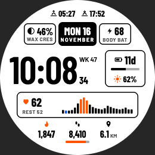
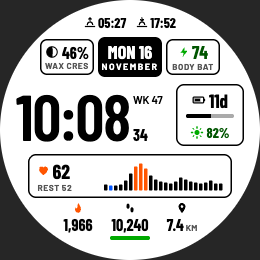
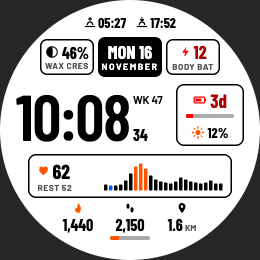

# Instrument Panel — fēnix 8 Solar watch face

A Connect IQ watch face for the Garmin fēnix 8 Solar 47mm, written in Monkey C.
It is designed for the 260 × 260 px always-on MIP (memory-in-pixel) screen and uses only its 64 colours.



> **Status:** version 1.0.0 is published on the Connect IQ Store. Engineering notes: https://davidbejar.github.io/garmin-mip-face-1/

## What it shows

- **Time** (24-hour), **seconds**, and the **ISO week number**
- **Date block**: weekday, day, and month
- **Sunrise and sunset** times
- **Moon phase**: icon, percent lit, and phase name
- **Body Battery**
- **Watch battery** in days remaining, with a charge bar, plus **solar intensity**
- **Heart rate**: current value, resting or 4-hour max (setting), and a 24-bar graph of the last 4 hours
- **Calories**, **steps** (with a progress bar toward the step goal), and **distance** (km or mi)

Every field shows a fallback (`--`, `--:--`) when its data is missing.

### Colour rules

Fields change colour to flag something worth noticing:

| Field | Condition | Colour |
|-------|-----------|--------|
| Heart-rate bars | ≥ 100 bpm | accent |
| Heart-rate bars | lowest bar in the graph | blue |
| Watch battery | < 4 days left | red |
| Solar | intensity > 75 | green |
| Body Battery | > 70 / < 15 | green / red |
| Steps bar | goal reached | green |

| Targets met | Running low |
|-------------|-------------|
|  |  |

### Settings

On the watch (this face's settings in the system Watch Face menu), or in Garmin Connect:

- **Text colour**: black (default), navy, or dark purple
- **Accent colour**: orange (default), magenta, or amber
- **Heart-rate label**: resting heart rate (`REST 52`, default) or the 4-hour max (`MAX 127`)
- **Time font**: Classic (default), Bold, LCD (7-segment, drawn in code), Dot matrix (drawn in code) or Handwritten
- **Rubber duck mode**: off (default) or on; every 2 in the hours and minutes becomes a yellow rubber duck

The colour options avoid the red, green and blue used by the colour rules, so warnings always stand out.

### Low power

The screen stays on. The face redraws once a minute; the seconds keep ticking through partial updates of just their own area (hidden only if the watch reports the power budget is exceeded).

## Building

Requirements: [Connect IQ SDK](https://developer.garmin.com/connect-iq/sdk/) 9.3.0 or newer, and a Connect IQ developer key.

```sh
# Build
monkeyc -f monkey.jungle -d fenix8solar47mm -o bin/WatchFace.prg -y /path/to/developer_key

# Run in the simulator
connectiq
monkeydo bin/WatchFace.prg fenix8solar47mm
```

Keep your developer key outside this repository.

## Documentation

Engineering notes (architecture, rendering, memory and power, algorithms, tooling) are in `docs/`, built with
MkDocs Material:

```sh
pip install -r requirements-docs.txt
mkdocs serve                       # http://127.0.0.1:8000
python3 tools/docs/make_assets.py  # regenerate figures after changing icons, glyphs or layout
```

## Project layout

- `design/spec.md`: the full design spec (layout coordinates, type, icons, colours, data sources, fallbacks)
- `design/*.png`: mockups for the normal, targets-met, and running-low states
- `CLAUDE.md`: working rules for the project

## History

Built in milestones, each committed after a simulator check:

1. Time, seconds, week number, date block
2. Outlined boxes and side panel: battery, solar, Body Battery, moon
3. Sunrise and sunset row
4. Heart-rate box with bar graph
5. Tile row: calories, steps with bar, distance
6. Colour rules
7. Low-power behaviour
8. Settings for text colour and accent
9. Time-font setting and rubber duck mode

Version 1.0.0 (tag `v1.0.0`) was approved by Garmin and published on the Connect IQ Store.

## License

[MIT](LICENSE). The bitmap fonts in `resources/fonts/` are derived from Barlow, Barlow Condensed, Saira Condensed and
Kalam and remain under the SIL Open Font License (licence texts alongside them).
