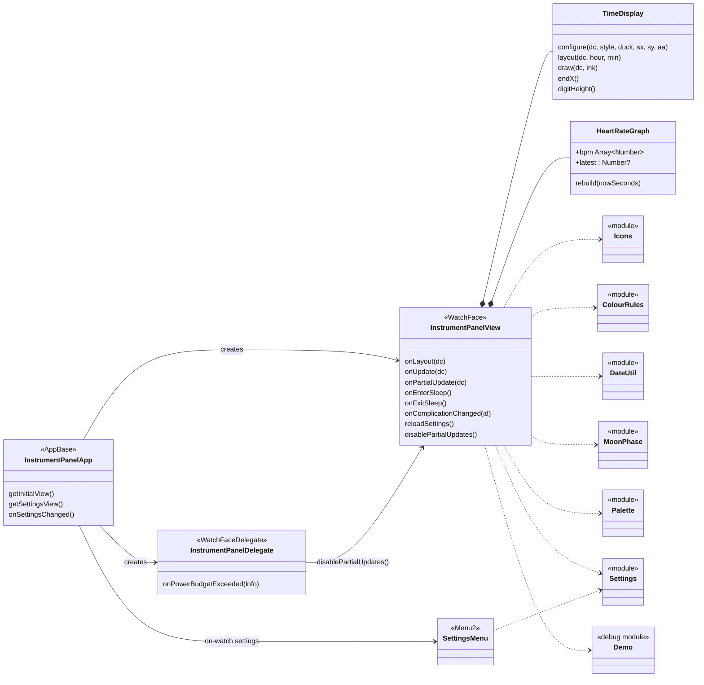
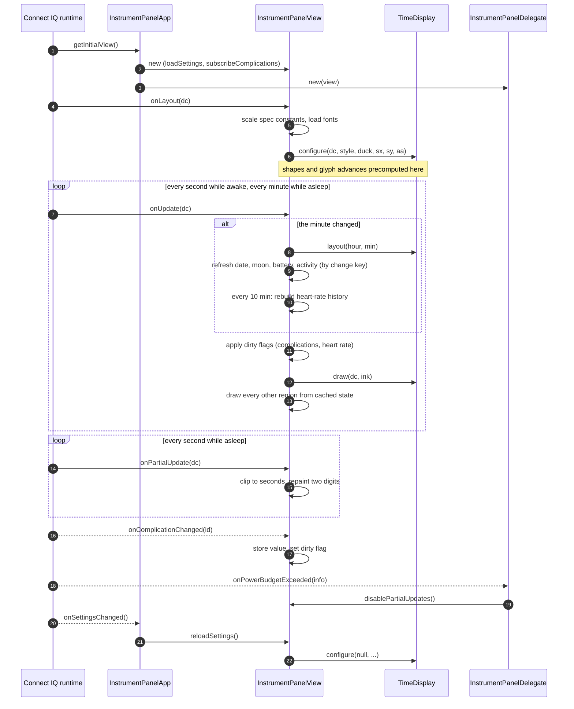

# Architecture

The face is a single Connect IQ application of type `watchface`. It has one view that owns all state, a few stateless
modules for pure logic and constant tables, and one helper class each for the two parts that carry their own state:
the time display and the heart-rate history.

## Components

| Unit | Kind | Responsibility |
|------|------|----------------|
| `InstrumentPanelApp` | `AppBase` | Entry point. Creates the view and delegate, provides the on-watch settings view and forwards setting changes to the view. |
| `InstrumentPanelView` | `WatchFace` | Owns layout, cached data, change detection and all drawing except the time digits. About half of the codebase. |
| `InstrumentPanelDelegate` | `WatchFaceDelegate` | Receives `onPowerBudgetExceeded` and switches the view out of per-second partial updates. |
| `TimeDisplay` | class | Hours and minutes in five styles plus rubber duck mode: font loading, glyph layout, precomputed polygons, drawing. |
| `HeartRateGraph` | class | Reads 4 hours of heart-rate history into 24 preallocated buckets and tracks the newest sample. |
| `SettingsMenu` + delegates | `Menu2` | Two-level on-watch settings menu that writes to `Application.Properties`. |
| `Icons` | module | Run-length pixel icons, the bolt polygon, the procedural moon and battery. No allocation. |
| `ColourRules` | module | Thresholds and the bar-colouring rule for the heart-rate graph, written into a caller-owned array. |
| `DateUtil` | module | ISO 8601 week numbers, day-of-year, leap years, weekday of 31 December. |
| `MoonPhase` | module | Phase from a reference new moon and the mean synodic month, percent lit, eight-step label. |
| `Palette` / `Settings` | modules | The fixed MIP colours, and typed access to stored settings with validation. |
| `Demo` | module, `(:debug)` | Mockup values and a fixed time for screenshot comparison. Excluded from release builds. |

!!! info "Why modules and not classes"
    Monkey C modules hold constants and functions without per-instance cost. Everything that has no state (icons,
    rules, calendar maths, moon maths, palette) is a module, so it adds no object or vtable overhead at runtime. Only
    `TimeDisplay` and `HeartRateGraph` hold state, and the view owns exactly one of each.

## Lifecycle

Three external events can arrive between frames: a complication update, a settings change and the power-budget
callback. None of them draws. Each one only updates state and marks it dirty, and the next `onUpdate` does the work.
So drawing happens in exactly two places, and every expensive computation runs only when its inputs change.

## Design principles in the code

1. **Spec coordinates, device pixels.** Every position is a constant on the 260 px design canvas and is scaled once
   in `onLayout`. See [Layout and scaling](layout.md).
2. **Compute on change, draw every frame.** Strings, text positions and colours are rebuilt only when their input
   changes. Frames only read caches. See [Rendering pipeline](rendering.md).
3. **No allocation in the frame path.** Scratch arrays are allocated once and refilled. Templates are precomputed and
   translated. See [Memory engineering](memory.md).
4. **Every field has a fallback.** `null` is a normal input, never a crash. See [Data sources](../data/sources.md).
5. **Capability checks, never assumptions.** `has :setAntiAlias`, `Toybox has :SensorHistory`,
   `stats has :batteryInDays`, and `try` around complication access.
6. **Debug code is compiled out.** `(:debug)` and `(:release)` annotations select between real and empty
   implementations at build time. See [Build, debug and release](../tooling/build.md).
