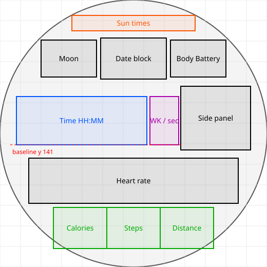

# Layout and scaling

## One coordinate system: the 260 px spec canvas

The design spec gives every element in pixels on a 260 × 260 canvas with its origin at the top left. The code uses
those numbers directly as named constants, and **never** uses device pixels in the source:

```js
private const DATE_X = 98.0;
private const DATE_Y = 37.0;
private const DATE_W = 64.0;
private const DATE_H = 40.0;
private const DATE_RADIUS = 7.0;
private const DATE_LINE1_BASELINE = 59.0;
```

`onLayout(dc)` computes two scale factors from the real drawing context and converts every constant once:

```js
_sx = dc.getWidth() / SPEC_SIZE;    // SPEC_SIZE = 260.0
_sy = dc.getHeight() / SPEC_SIZE;
```

On the fēnix 8 Solar 47mm both factors are exactly 1.0, but the face makes no assumption about it. The same source
lays itself out proportionally on any round screen, and the constants read like the spec, which makes review against
the spec a line-by-line comparison.

{ width="520" }

*Regions of the face on the spec canvas, generated from the constants in `InstrumentPanelView.mc` by
`tools/docs/make_assets.py`. The dashed line is the shared baseline of the time and seconds.*

## Rounding without drift

Scaling a box's position and size separately can leave a 1 px gap or overlap between neighbours, because
`round(x * s) + round(w * s)` is not always `round((x + w) * s)`. The code always scales **edges** and derives sizes
from them:

```js
var x = scaleX(b[0]);
var y = scaleY(b[1]);
_boxes[i] = [x, y, scaleX(b[0] + b[2]) - x, scaleY(b[1] + b[3]) - y, scaleX(b[4])];
```

The same pattern is used for the date block, the battery bar and the steps bar. Adjacent elements in the spec stay
adjacent on any screen size.

## Edge cases the layout has to survive

| Constraint | How it is handled |
|------------|-------------------|
| The screen is a circle of radius 130. Nothing may be drawn outside it. | The tile row is narrowest at the bottom. The steps bar is the only tile with a bar, so it sits in the **middle** column, where the circle is widest. |
| The time's width varies by minute and by font (`11:11` vs `00:00`). | The week number and seconds column follow `TimeDisplay.endX()` plus a 3 px gap. Every time style was checked over all 1,440 minutes so the column always clears the side panel at x 176. |
| Labels must not run into the side panel at the widest time. | The week number moved from the mockup's 11 px font (30–31 px wide) to the 7 px label font (27–28 px). It now clears the panel by at least 3 px at every minute of the day, including `04:44`. |
| Heart rate goes from 2 to 3 digits. | The heart icon, value and label have fixed x positions instead of being centred, so nothing jumps at 99 → 100 bpm. The heart-rate font has fixed-width digits. |
| Month names vary from 3 to 9 letters. | Letters are placed one by one with 2 px tracking, which drops to 1 px if the name would exceed 52 px (only SEPTEMBER does). The result is centred in the date block. |
| Different time fonts have different digit heights. | The week number's top follows the digit tops: `WEEK_BASELINE + CLASSIC_DIGIT_H - digitHeight()`. |
| Distance has a value and a smaller unit ("6.1 KM"). | Both are measured and centred together on the column, each at its own font's baseline. |

## The seconds column

The seconds share the time's baseline (y 141) and sit 3 px to the right of the last time glyph. Because they are
redrawn alone in low power (see [Low power](low-power.md)), their clip rectangle has to contain every value from 00 to
59 and nothing else:

```js
for (var i = 0; i < 10; i++) {
    _secondsAdvance[i] = dc.getTextWidthInPixels(i.toString(), _num12Font);
}
// widest = the largest advance
_secondsClipY = scaleY(SECONDS_BASELINE - SECONDS_DIGIT_H) - 1;
_secondsClipH = scaleY(SECONDS_BASELINE) + 1 - _secondsClipY;
_secondsClipW = 2 * widest + 1;
```

The rectangle is derived from the real font metrics, with a 1 px margin on each side, so it stays correct if the font
is regenerated at another size.

## Fonts are scaled too

The bitmap fonts are rasterised at their 260 px size, so they are exact on the target device. The one system vector
font (Roboto Condensed Bold for the date line "FRI 20") is requested at a size computed from the wanted **cap height**:

```js
// Cap height as a fraction of getVectorFont's :size. The size is the font's
// full line height (hhea ascent + descent), not the em: confirmed in the
// simulator. From the TTF metrics, Roboto Condensed Bold: cap 1456 / (1900 + 500).
private const ROBOTO_CONDENSED_CAP_RATIO = 0.607;

_cap13Font = vectorFont("RobotoCondensedBold", CAP_13 / ROBOTO_CONDENSED_CAP_RATIO, Graphics.FONT_SMALL);
```

The API documentation doesn't say what `:size` measures. It was established empirically in the simulator, checked
against the TTF's `hhea` metrics, and written down next to the constant. `vectorFont()` falls back to a system bitmap
font if the vector face is unavailable.
