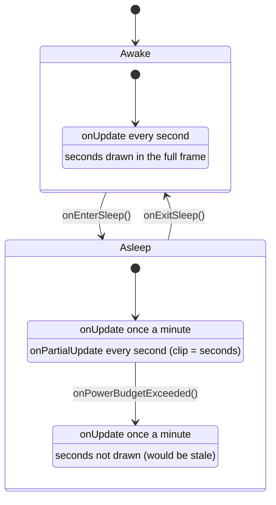

# Low power and partial updates

## The requirement

The fēnix 8 Solar's MIP screen is always on. When the wrist is down, the watch enters low power. A Connect IQ face
then gets a full `onUpdate` only **once a minute**, which would freeze the seconds.

The owner wanted the seconds to keep ticking in low power. Connect IQ supports this through **partial updates**: in
low power, `WatchFace.onPartialUpdate(dc)` is called every second and may redraw a small region. The system enforces
a per-face **power budget** on how long those calls take, averaged over time. If a face exceeds it, the system
calls `WatchFaceDelegate.onPowerBudgetExceeded` and stops partial updates.

The resulting design:

- Full redraw once a minute in low power.
- Seconds redrawn every second through `onPartialUpdate`, clipped to the seconds' rectangle only.
- If the budget is exceeded, stop partial updates and **hide** the seconds while asleep, rather than show a frozen
  value that would be wrong.

## State machine



After the budget is exceeded, `_partialUpdates` stays `false` for the life of the face. Waking the watch shows the
seconds again (full frames run every second while awake), and they are hidden again on the next sleep.

## The partial update

```js
function onPartialUpdate(dc as Dc) as Void {
    if (!_partialUpdates) {
        return;
    }
    var sec = System.getClockTime().sec;
    dc.setClip(_sideX, _secondsClipY, _secondsClipW, _secondsClipH);
    dc.setColor(Palette.BACKGROUND, Palette.BACKGROUND);
    dc.fillRectangle(_sideX, _secondsClipY, _secondsClipW, _secondsClipH);
    drawSeconds(dc, sec);
    dc.clearClip();
}
```

The design choices behind these few lines:

| Choice | Reason |
|--------|--------|
| `fillRectangle` of exactly the clip, not `dc.clear()` | A clear touches the whole buffer. The fill touches only the pixels that can change. This was changed during the low-power milestone. |
| Clip computed in `onLayout` from font metrics | It must contain every value 00–59 at any time width, and nothing else. See [Layout](layout.md#the-seconds-column). |
| `_sideX` comes from the minute layout | The seconds column moves with the width of HH:MM. The partial update reads the value cached by the last full frame, so both paths agree. |
| Two `drawText` calls with one digit each | No string formatting, so no allocation, every second. |
| Seconds drawn last in `onUpdate` | Nothing else overlaps the clip, so painting it white never erases a neighbour. |

## The delegate

```js
class InstrumentPanelDelegate extends WatchUi.WatchFaceDelegate {
    function onPowerBudgetExceeded(powerInfo as WatchUi.WatchFacePowerInfo) as Void {
        _view.disablePartialUpdates();
    }
}
```

`disablePartialUpdates()` sets the flag and requests a redraw. `drawTime` then skips the seconds while
`_sleeping && !_partialUpdates`.

## Verification

Checked in the Connect IQ simulator (Display Mode → Always-On) during milestone 7:

- [x] Full redraw once a minute in low power.
- [x] Seconds tick through partial updates: about **1 ms on average, 4 ms worst case** on the host.
- [x] Waking returns to per-second full frames.
- [x] The power-budget fallback hides the seconds while asleep and restores them on wake.

!!! note "Limits of the simulator"
    The simulator doesn't raise `onPowerBudgetExceeded` by itself (only its watchdog does). The fallback's
    behaviour was checked in the simulator, but the real trigger can only be observed on a watch.

## A rule written for future contributors

Always-on seconds were a deliberate product decision, and the easiest way to "fix" a power problem is to remove
them. The project instructions forbid that and spell out the only allowed exception: the power-budget callback. Any
change that risks the budget has to be discussed first. Writing the constraint down protects the behaviour from
well-meant simplification later.
