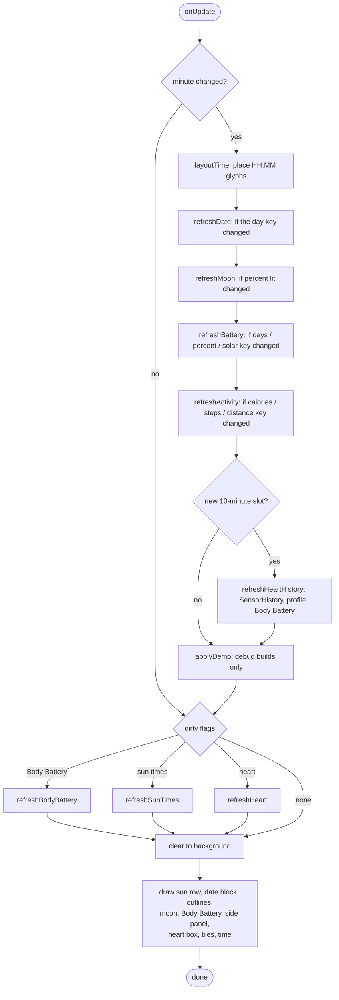

# Rendering pipeline

A watch face's `onUpdate` runs once a second while the watch is awake. On an MIP device the system then keeps
calling it once a minute in low power, and `onPartialUpdate` runs every second. Each call is a chance to waste battery
and to trigger the garbage collector. The pipeline is built around one rule:

> **Work happens when data changes. Frames only draw.**

## Two phases per frame



**Phase 1, refresh** (top half) turns raw data into display-ready state: strings, x positions, colours and bar
heights. It runs at most once a minute, plus whenever a complication pushes a new value.

**Phase 2, draw** (bottom box) is a fixed sequence of `draw*` functions that read only cached fields. None of them
builds a string, measures text or evaluates a colour rule.

## Change keys

Each refresh function compares a compact integer **key** with the last one and returns early if nothing changed. The
keys pack every input that affects the output into a single `Number`:

| Field | Key | Why that encoding |
|-------|-----|-------------------|
| Date | `(year * 13 + month) * 32 + day` | Unique per calendar day. Rebuilds the weekday, week number and letter-spaced month. |
| Battery | `days`, or `1000 + percent` when the device gives no days estimate | One key covers both display modes ("11d" or "52%") without a separate flag. |
| Solar | `-1` without a sensor, `0` when intensity is negative, else the intensity | Collapses "not charging" and "0%" into one displayed state. |
| Distance | `tenths * 2 + (statute ? 1 : 0)` | Includes the unit, so switching km ↔ mi in the device settings invalidates the cache even if the number is the same. |
| Calories, steps | the value, or `-1` for `null` | |
| Moon | percent lit | The label and icon follow the phase. Text and positions follow the percent. |
| Heart-rate graph | `minute / 10` | Sensor history is re-read when a new 10-minute bar starts. |

`invalidateCaches()` resets every key to an impossible value. It runs on `onLayout`, `onShow` (the time zone may have
changed while the face was hidden) and after a settings change, so the next frame rebuilds everything.

```js
// InstrumentPanelView.applyBattery (abridged)
var key = (days != null) ? days : 1000 + percent.toNumber();
if (key != _batteryKey) {
    _batteryKey = key;
    _batteryText = (key < 1000) ? key.toString() + "d" : (key - 1000).toString() + "%";
    _batteryIconX = rowLeft(dc, BOX_SIDE, Icons.BATTERY_W, ICON_GAP, _batteryText, _num13Font);
    _batteryTextX = round(_batteryIconX + (Icons.BATTERY_W + ICON_GAP) * _sx);
}
```

The string concatenation, the text measurement and the centring maths all sit inside the `if`. On most minutes the
battery days don't change, so none of it runs.

## Dirty flags for push data

Complications are pushed by the system through `onComplicationChanged(id)`. The callback only stores the value and
sets a flag. It never formats or draws:

```js
function onComplicationChanged(id as Complications.Id) as Void {
    if (id.equals(_bodyBatteryId)) {
        _bodyBattery = readComplication(_bodyBatteryId);
        _bodyBatteryDirty = true;
    } else if (id.equals(_sunriseId)) { ... }
}
```

The next `onUpdate` sees `_bodyBatteryDirty`, rebuilds the text, re-centres the icon and text row, re-evaluates the
green/red colour rule, and clears the flag. Several pushes between two frames therefore cost one rebuild.

## Draw order

The draw sequence is fixed and also defines the stacking order:

1. Clear to white, which also removes anything left behind by partial updates.
2. Sunrise and sunset row.
3. Date block (a filled rounded rectangle, then white text).
4. Box outlines, 2 px, drawn as nested 1 px rounded rectangles so the corner radius stays exact at every width.
5. Moon box, Body Battery box, side panel, heart-rate box, tile row.
6. Time last: hours and minutes through `TimeDisplay.draw`, then the week number and the seconds.

The seconds are drawn last for a practical reason. `onPartialUpdate` repaints the seconds' clip rectangle with the
background colour, and nothing else may overlap that rectangle. Drawing them last in the full frame keeps the two
code paths producing the same pixels.

## Text positioned by baseline

The spec gives baselines measured from the mockups, not text-box tops. Connect IQ's `drawText` positions by the top
of the font cell, so a helper converts once per font in `onLayout`:

```js
//! Top of the text cell that puts the font's baseline on the given spec y.
private function topForBaseline(baseline as Float, font as FontType) as Number {
    return scaleY(baseline) - Graphics.getFontAscent(font);
}
```

This is why fonts with very different line heights (a 64 px time font, a 9 px label font, a system vector font)
still line up on the same baselines as the mockup.

## Icon and text rows centred on a box

Most boxes contain an icon, a gap and a value, centred as one unit. A shared helper computes the left edge from the
icon width in spec pixels and the measured text width in device pixels:

```js
private function rowLeft(dc as Dc, box as Number, iconW as Float, gap as Float,
        text as String, font as FontType) as Float {
    var width = (iconW + gap) * _sx + dc.getTextWidthInPixels(text, font);
    return boxCentreX(box) - width / 2;
}
```

It is called only inside a key check, so `getTextWidthInPixels` runs once per value change, not once per frame.

## Avoiding allocation in drawing

Monkey C has no stack-allocated arrays: every `[x, y]` literal is a heap object. The drawing code avoids them like
this:

- **Polygons** (the bolt, the 7-segment segments, the duck) are drawn by copying precomputed template points plus an
  offset into **scratch arrays** allocated once (`_boltPoints`, `_p4`, `_p5`, `_p6`, `_p12`), then calling
  `fillPolygon` on the scratch array.
- **Seconds** are drawn as two single-digit `drawText` calls with a measured advance (`_secondsAdvance[tens]`), not by
  formatting `"%02d"`, which would allocate a string every second.
- **The month name** is stored as a `Char` array with precomputed x positions. Each letter is drawn individually so
  the letter spacing is exact in whole pixels.
- **Colour rules** write into caller-owned arrays (`ColourRules.graphBarColours(bpm, out, ink, accent)`).

See [Memory engineering](memory.md) for the full list and the measurements.

## Debug hooks in the frame

Two calls in the minute branch, `applyDemo(dc)` and `logMemory("minute")`, have a `(:debug)` and a `(:release)`
implementation. The release versions are empty, so release builds contain no demo data and no logging strings. See
[Build, debug and release](../tooling/build.md).
