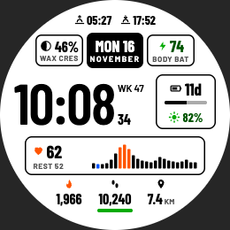
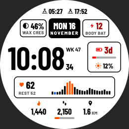

# Colour on a 64-colour screen

## The MIP palette

The fēnix 8 Solar's memory-in-pixel display shows **64 colours**: each of red, green and blue is one of four levels,
`0x00`, `0x55`, `0xAA` or `0xFF`. Any other value is quantised by the hardware, often to something unexpected. The
project's rule is that every colour in the source must be one of the 64, and `Palette.mc` holds the fixed ones:

| Role | Value | |
|------|-------|-|
| Background | `#FFFFFF` |  |
| Small labels (moon phase, BODY BAT, KM) | `#555555` |  |
| Bar track | `#AAAAAA` |  |
| Red: icons and bars | `#FF0000` |  |
| Red: numbers | `#AA0000` |  |
| Green: icons and bars | `#00AA00` |  |
| Green: numbers | `#005500` |  |
| Lowest heart-rate bar | `#0055FF` |  |
| Duck body (fixed) | `#FFFF00` |  |
| Duck beak (fixed) | `#FF5500` |  |

!!! tip "Two shades per signal"
    Each signal colour has a bright shade for **areas** (icons, bars) and a dark shade for **numbers**. Digits
    are thin strokes on white, so they get the darker, higher-contrast shade, while icons and bars, which have more
    area, carry the brighter one.

The `REST` / `MAX` label under the heart rate uses the **text colour** rather than the label grey. It is a value
the wearer reads, not a caption, and in grey its 1 px letter strokes were too light on the watch. It now matches
the week number, which uses the same font.

## Colour rules

The face uses colour sparingly, to flag something worth noticing:

| Field | Condition | Effect |
|-------|-----------|--------|
| Heart-rate bars | value ≥ 100 bpm | bar in the accent colour |
| Heart-rate bars | lowest bar (first if tied), if below 100 | bar `#0055FF` |
| Watch battery | fewer than 4 days left | icon and bar `#FF0000`, number `#AA0000` |
| Solar | intensity > 75 | icon `#00AA00`, number `#005500` |
| Body Battery | > 70 | icon `#00AA00`, number `#005500` |
| Body Battery | < 15 | icon `#FF0000`, number `#AA0000` |
| Steps bar | steps ≥ goal | fill `#00AA00` |

Thresholds live in one module (`ColourRules.mc`) as named constants. The rules are evaluated **only when the
underlying value changes** (inside the refresh functions), and the resulting colours are cached in fields such as
`_batteryIconColour` and `_bodyBatteryTextColour`. Drawing just reads them.

One rule depends on what the device reports: the battery is flagged red only when it gives a **days** estimate. If
it reports a percent only, the change key is ≥ 1000 and the rule can't fire. A percentage isn't comparable with
"4 days".

<figure markdown>

<figcaption>Targets met: Body Battery 74, solar 82 %, step goal reached</figcaption>
</figure>
<figure markdown>

<figcaption>Running low: 3 days of battery, Body Battery 12</figcaption>
</figure>

## User colours that cannot hide a warning

The text colour and accent are settings. The first draft offered dark green, dark red, blue, red and green among
the options. With those, a red warning drawn in a red-accented face, or a green "target met" on dark-green text,
would be invisible.

The final option lists deliberately avoid the rule colours:

| Setting | Options |
|---------|---------|
| Text colour | black `#000000` (default), navy `#000055`, dark purple `#550055` |
| Accent | orange `#FF5500` (default), magenta `#AA00AA`, amber `#FFAA00` |

So whatever the user picks, red still means "low" and green still means "good". Changing a setting calls
`invalidateCaches()`, which re-runs every rule with the new ink and accent on the next frame.

## Anti-aliasing, selectively

On a 64-colour screen anti-aliasing produces intermediate colours that the panel quantises. Large shapes look
smoother. Thin strokes at small sizes look blurred and grey. The face decides per element:

| Element | Edges | Why |
|---------|-------|-----|
| Classic, Bold, Handwritten time digits | anti-aliased bitmap font | Large glyphs (41–47 px) benefit from smooth curves. |
| Dot-matrix time | anti-aliased `fillCircle` | Round dots at about 6 px look like squares without it. |
| Rubber duck | anti-aliased polygons and circles | Except in the LCD style, where the segments are hard-edged. |
| LCD time | hard edges | Matches real 7-segment displays. |
| All small numbers and labels | hard-edged (threshold or 1-bit) fonts | 7–15 px text stays crisp and black. |

`dc.setAntiAlias` was confirmed in the SDK docs as API 3.2.0+ and listed for the device, and it is still guarded with
`dc has :setAntiAlias`. It is switched on only around the shapes that need it and switched off afterwards.
