# Bitmap font pipeline

## Why custom fonts

The spec's mockups used Barlow and Barlow Condensed. On the watch, the system fonts failed in two different ways:

- **Too wide at large sizes.** At the mockup's 64 px, the system font's time was wider than the space between the
  left edge and the side panel.
- **Too soft at small sizes.** Anti-aliased 6–7 px capitals and thin digits came out grey and fuzzy on the
  reflective MIP panel.

`tools/make_fonts.py` converts the open-licensed TTFs into BMFont bitmap fonts (a `.fnt` text descriptor plus a
`.png` atlas), which Connect IQ loads as font resources. It writes only the glyphs each use needs, at the exact pixel
size, with the right edge treatment.

## Font table

All fonts come from one declarative table:

```python
# name, source TTF, pixel size, glyphs, edge mode, gap[, space[, fixed]]
FONTS = [
    ("time",       "BarlowCondensed-SemiBold.ttf", 64, "0123456789:", "aa", None),
    ("time_saira", "SairaCondensed-ExtraBold.ttf", 60, "0123456789:", "aa", None),
    ("time_kalam", "Kalam-Bold.ttf",               48, "0123456789:", "aa", None),
    ("num12", "BarlowCondensed-Bold.ttf",     17, "0123456789%d-,.", "threshold", None),
    ("num13", "BarlowCondensed-Bold.ttf",     18, "0123456789%d-",   "threshold", None),
    ("num11", "BarlowCondensed-Bold.ttf",     14, "0123456789%d-",   "threshold", None),
    ("num15", "BarlowCondensed-SemiBold.ttf", 20, "0123456789-",     "threshold", 2, None, True),
    ("sun11", "BarlowCondensed-SemiBold.ttf", 14, "0123456789-:",    "threshold", None),
    ("month", "Barlow-Bold.ttf", 9, <the 21 letters of the month names>, "mono", 0),
    ("label", "Barlow-Bold.ttf", 9, "A–Z0–9 -", "mono", 1, 2),
]
```

`python3 tools/make_fonts.py num15 label` rebuilds only those fonts and leaves the rest byte-identical, so a change
to one font produces a minimal diff.

## Three edge modes

| Mode | How | Used for |
|------|-----|----------|
| `aa` | Pillow's anti-aliased render, coverage kept in alpha | The three large time fonts |
| `threshold` | Anti-aliased render, then `alpha ≥ 128 → 255, else 0` | Small numbers: crisp, but follows the outline faithfully |
| `mono` | FreeType's hinted 1-bit render (`draw.fontmode = "1"`) | 7 px capitals: hinting snaps stems to whole pixels |

The size per font is the one at which **hinting lands on the wanted digit height**. Not every height is reachable:
for example 17 px Barlow Condensed Bold gives 12 px digits and 18 px gives 13 px, but no size gives a clean 14 px
digit with hard edges. Each choice is commented in the table with what was tried.

## Glyph processing

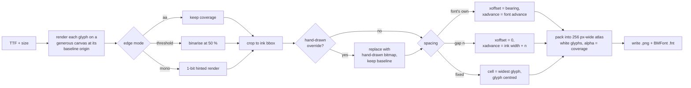

### Side bearings in metadata, not pixels

Each glyph is cropped to its inked pixels. The side bearings are recorded in the BMFont `xoffset` and `xadvance`
fields instead of being stored as transparent atlas pixels, which keeps the atlases small. The small fonts' PNGs are
313–474 bytes.

### White glyphs, colour at draw time

The atlas is white with coverage in the alpha channel, so the same font draws in any colour set with
`dc.setColor`. This is needed because the text colour is a user setting and the colour rules recolour numbers.

### Spacing modes

- **Font's own spacing** for the time digits, adjusted in code with per-style tracking (`TRACKING = [-1.25, -1.2, …]`).
- **Fixed gap** for labels: every letter exactly 1 px from the next and words 2 px apart. The font's own spacing
  crowded `1ST QTR` at 7 px.
- **Fixed width** for heart-rate digits: every digit gets the widest digit's cell, centred, so the number doesn't
  shift as it changes. The generator prints the resulting widths of the widest labels and month names so they can
  be checked against the space available.

### Hand-drawn glyphs where the renderer fails

At 7 px capitals, the hinted renderer produced broken digits: a 5 that read as a 6, a split 4, and stray pixels in 3
and 7. Those digits are replaced by hand-drawn 5 × 7 bitmaps with 2 px strokes, written as strings in the generator
so they are reviewable and versioned:

```python
"4": ["...##", "..###", ".#.##", "#..##", "#####", "...##", "...##"],
"5": ["#####", "##...", "####.", "...##", "...##", "##.##", ".###."],
```

The override keeps the glyph's baseline. They are used by the week number and the REST/MAX label.

## The atlases

Rendered from `resources/fonts/*.png` on a dark tile so the white glyphs are visible:

<figure markdown>
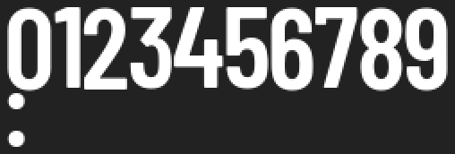{ .pixel }
<figcaption><code>time</code>: Barlow Condensed SemiBold 64 px, anti-aliased (Classic)</figcaption>
</figure>

<figure markdown>
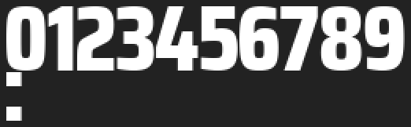{ .pixel }
<figcaption><code>time_saira</code>: Saira Condensed ExtraBold, anti-aliased (Bold)</figcaption>
</figure>

<figure markdown>
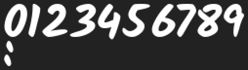{ .pixel }
<figcaption><code>time_kalam</code>: Kalam Bold, anti-aliased (Handwritten)</figcaption>
</figure>

| Font | Atlas (4× scale) |
|------|------------------|
| `num15` | 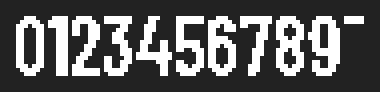{ .pixel } |
| `num13` | 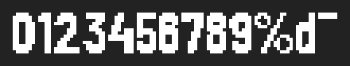{ .pixel } |
| `num12` | 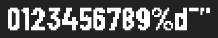{ .pixel } |
| `num11` | 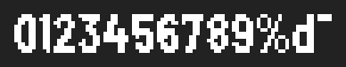{ .pixel } |
| `sun11` | 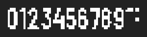{ .pixel } |
| `month` | 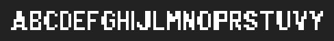{ .pixel } |
| `label` | 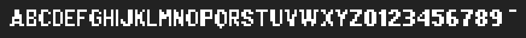{ .pixel } |

## Resource declaration

```xml
<fonts>
    <font id="TimeFont"  filename="time.fnt"  filter="0123456789:" antialias="true" />
    <font id="Num12Font" filename="num12.fnt" antialias="false" />
    <font id="LabelFont" filename="label.fnt" antialias="false" />
    ...
</fonts>
```

`filter` restricts the compiled resource to the listed characters, and `antialias` must match the edge mode.

## Fitting the time fonts

The two extra time fonts had to fit **exactly** the box the classic time uses: digits at most 47 px tall, and the
widest possible time at most 127 px including the code's tracking, so the week number always clears the side panel.
The size in the table is the largest that passes over **all 1,440 times**, found with the
[preview renderer](../tooling/preview.md). That gives 41 px digits for Saira and 35 px for Kalam, whose
handwritten glyphs are much wider for their height.

## Licensing

Barlow, Barlow Condensed, Saira Condensed and Kalam are under the SIL Open Font License. The licence texts are
included both next to the source TTFs (`tools/fonts/`) and next to the generated resources (`resources/fonts/`),
since the bitmaps are derived works.
