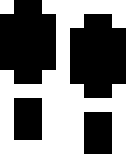
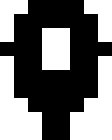
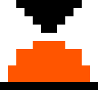
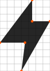

# Icons drawn in code

The face has 10 icons of 6–14 px. Several change colour under the colour rules (the battery turns red, the sun
green, the bolt green or red), and all follow the user's text or accent colour. Pre-coloured bitmaps would need one
resource per colour combination, so every icon is drawn in code at draw time in whatever colour is set.

There are four techniques, depending on the shape.

## 1. Run-length pixel art

Most icons were traced pixel by pixel from the mockup and stored as horizontal **runs**: `(row, x, width)` triples,
flattened into a single `Array<Number>`.

```js
//! Draws a run-encoded pixel icon (row, x, width triples), scaled by s.
function drawRuns(dc as Dc, runs as Array<Number>, left as Float, top as Float, s as Float) as Void {
    for (var i = 0; i < runs.size(); i += 3) {
        var row = runs[i];
        var x = runs[i + 1];
        var w = runs[i + 2];
        var x0 = (left + x * s + 0.5).toNumber();
        var x1 = (left + (x + w) * s + 0.5).toNumber();
        var y0 = (top + row * s + 0.5).toNumber();
        var y1 = (top + (row + 1) * s + 0.5).toNumber();
        dc.fillRectangle(x0, y0, x1 - x0, y1 - y0);
    }
}
```

Rounding **both edges** of each run, not the position and the width separately, keeps adjacent runs seamless at
non-integer scales.

The figures below are generated from the arrays in `Icons.mc` by `tools/docs/make_assets.py`. Each grid square is one
screen pixel.

<div class="icons" markdown>
<figure markdown>

<figcaption>Solar, 12×13</figcaption>
</figure>
<figure markdown>

<figcaption>Heart, 9×9</figcaption>
</figure>
<figure markdown>

<figcaption>Calories, 6×10</figcaption>
</figure>
<figure markdown>

<figcaption>Steps, 9×11</figcaption>
</figure>
<figure markdown>

<figcaption>Distance, 8×10</figcaption>
</figure>
<figure markdown>

<figcaption>Sunrise, 12×11</figcaption>
</figure>
<figure markdown>

<figcaption>Sunset, 12×11</figcaption>
</figure>
</div>

Details that only show at this size:

- **Sun.** A 1 px gap separates the side rays from the disc, so on the MIP screen they read as rays instead of
  merging into a blob.
- **Steps.** The mockup's 8 px footprints read as two dots on the watch. They were redrawn as two shoe prints, each
  with a separate forefoot and heel, the right one a step lower.
- **Sunrise and sunset.** These are new designs, not in the mockup. A solid half-sun in the accent colour sits on a
  horizon line, with a triangle in the text colour pointing up or down. They are two-colour icons, so
  `drawSunEvent` takes both colours as parameters and switches between them.

## 2. A polygon: the bolt

The Body Battery bolt has diagonal edges that pixel runs would make jagged. It is a 6-point polygon on a 7 × 10 grid:

```js
const BOLT_POINTS = [[4.5, 0.0], [4.5, 3.0], [7.0, 3.0], [3.0, 10.0], [3.5, 6.0], [0.0, 6.0]];
```



`fillPolygon` needs an array of points. Building one per frame would allocate seven objects, so the caller passes a
preallocated 6-point scratch array (`_boltPoints`, created in `onLayout`) that `drawBolt` refills with the scaled and
translated vertices.

## 3. Procedural: the moon

The moon is computed rather than stored. It is a circle outline plus one `fillRectangle` per pixel row for the unlit
part, with the terminator at \(x = w\cos 2\pi\varphi\). See
[Calendar and moon maths](../data/calendar-and-moon.md#drawing-the-terminator).

## 4. Primitives: the battery

The battery is an outlined rectangle, a nub, and an inner fill whose width is the charge (0–1). All three are integer
rectangles computed from the scale with 2 px insets:

```js
dc.drawRectangle(x, y, bodyW, h);
dc.fillRectangle(x + bodyW, y + two, two, h - 2 * two);          // nub
var fill = (inner * clamp01(charge) + 0.5).toNumber();
if (fill > 0) { dc.fillRectangle(x + two, y + two, fill, h - 2 * two); }
```

Under the icon, the 48 × 4 charge bar has rounded ends. Its fill has to end **square** at any charge level. This is
done by drawing the full rounded bar in the fill colour with a clip set to the filled width:

```js
dc.setClip(_barX, _barY, fill, _barH);
dc.fillRoundedRectangle(_barX, _barY, _barW, _barH, radius);
dc.clearClip();
```

## Box outlines

The four outlined boxes have 2 px borders with corner radii of 7 and 8. `drawRoundedRectangle` draws 1 px lines, so
the 2 px outline is made of nested rectangles, each inset by 1 px with the radius reduced by 1. This keeps the
corners concentric at any outline width:

```js
for (var k = 0; k < _outlineWidth; k++) {
    dc.drawRoundedRectangle(b[0] + k, b[1] + k, b[2] - 2 * k, b[3] - 2 * k, b[4] - k);
}
```
