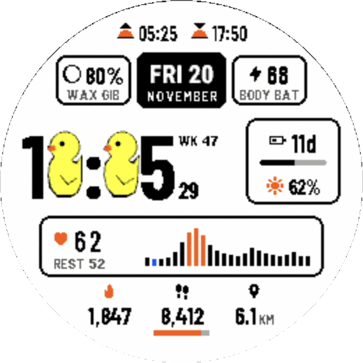
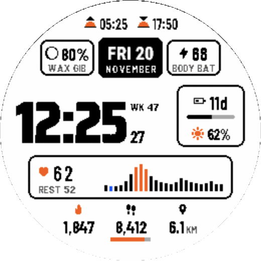
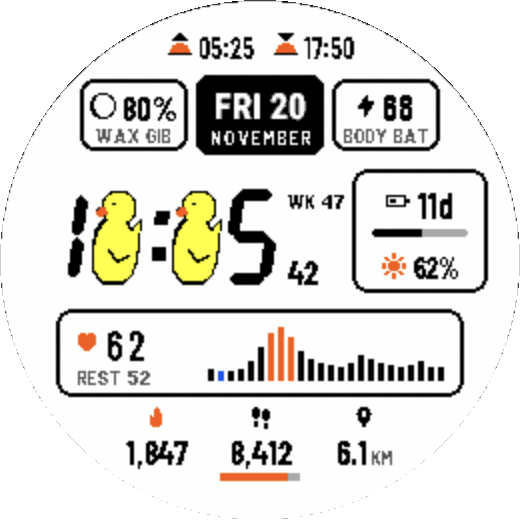
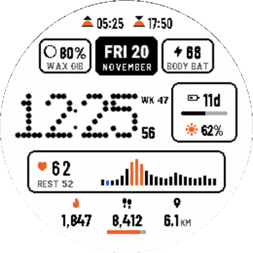
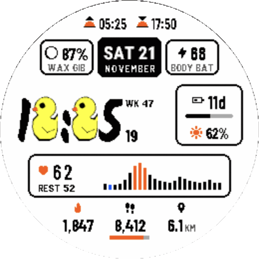
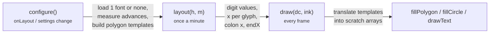
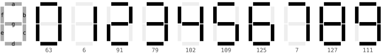
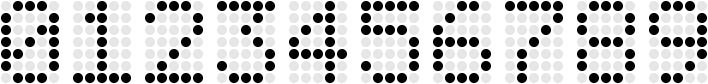

# Time styles and the rubber duck

`TimeDisplay` draws the hours and minutes in one of five styles, with an optional **rubber duck mode** that replaces
every digit 2 with a small yellow duck. Three styles are bitmap fonts. Two are geometry generated at runtime from
compact tables. All five fit the exact box of the default time, so nothing else on the face moves when the style
changes.

<div class="screens" markdown>
<figure markdown>

<figcaption>Classic + ducks</figcaption>
</figure>
<figure markdown>

<figcaption>Bold</figcaption>
</figure>
<figure markdown>

<figcaption>LCD + ducks</figcaption>
</figure>
<figure markdown>

<figcaption>Dot matrix</figcaption>
</figure>
<figure markdown>

<figcaption>Handwritten + ducks</figcaption>
</figure>
</div>

*Captured from the Connect IQ simulator at 12:25 with the mockup data.*

## The fitting contract

Every style must satisfy the same constraints as the classic time:

| Constraint | Value (spec px) |
|------------|-----------------|
| Left edge | x 16 |
| Baseline | y 141 |
| Digit height | ≤ 47 |
| Widest possible time | ≤ 127, so the week number (28 px) plus a 3 px gap clears the side panel at x 176 |

The "widest possible time" is checked over **all 1,440 minutes**, because which time is widest depends on each font's
digit widths. The check runs in the [preview renderer](../tooling/preview.md) before any Monkey C
is written. The commit that added the styles records a margin of at least 3 px in every style.

`TimeDisplay` exposes `endX()` (the right edge of the laid-out time) and `digitHeight()`. The view places the week
number and seconds from those values, so it doesn't need to know which style is active.

| Style | Implementation | Digit height | Resource |
|-------|----------------|-------------:|--------|
| Classic | Barlow Condensed SemiBold bitmap font | 47 px | one 5 KB PNG atlas |
| Bold | Saira Condensed ExtraBold bitmap font | 41 px | one 4 KB PNG atlas |
| LCD | 7 hexagonal polygons per digit, slanted | 47 px | no resource |
| Dot matrix | 5 × 7 grid of anti-aliased circles | 45.4 px | no resource |
| Handwritten | Kalam Bold bitmap font, glyphs narrowed to 84 % | 44 px | one 8 KB PNG atlas |

## Lifecycle: configure, layout, draw



All allocation happens in `configure()`. `layout()` writes into fixed arrays (`_digits[4]`, `_x[4]`). `draw()`
copies template points plus an offset into preallocated scratch arrays and fills them.

## LCD: a 7-segment display from polygons

### Segment encoding

Each digit is a 7-bit mask over segments `a`–`g` (bit 0 = `a`):

```js
private const SEG_MASK = [63, 6, 91, 79, 102, 109, 125, 7, 127, 111] as Array<Number>;
//                        0   1  2   3   4    5    6    7  8    9
```



*Segment map (left) and the ten digits rendered from `SEG_MASK`, generated from the source. The numbers are the
mask values.*

### Segment geometry

Each segment is a **hexagon** with pointed ends, so neighbouring segments meet at a mitre with a small gap like a
real LCD. Horizontal segments come from `hSeg`, vertical ones from `vSeg`, with parameters for stroke `t = 5`, gap
`g = 1` and cell width 23:

```js
private function hSeg(y, l, r, h2, g, h) {
    return segPoints([
        l + g, y,   l + h2 + g, y - h2,   r - h2 - g, y - h2,
        r - g, y,   r - h2 - g, y + h2,   l + h2 + g, y + h2
    ], h);
}
```

### Slant

The cell coordinates are converted to pixels relative to the cell's bottom-left corner on the baseline, with a shear
that leans the top to the right:

\[
x' = \big(x + (h - y)\cdot 0.10\big)\, s_x, \qquad y' = (y - h)\, s_y
\]

The shear is applied once, when the template is built. Drawing a digit is then seven `fillShifted` calls for the
segments whose bit is set:

```js
var mask = SEG_MASK[d];
for (var s = 0; s < 7; s++) {
    if ((mask & (1 << s)) != 0) {
        fillShifted(dc, _segs[s], _p6, _x[i], y);
    }
}
```

The colon is two squares built the same way. Because of the slant, the right edge of the time is the last cell plus
`digitHeight × slant`, and `endX()` includes it so the week number doesn't touch the leaning top of the last digit.

## Dot matrix: a 5 × 7 font in 70 numbers

Each digit is 7 rows of 5 bits, bit 4 being the left column, stored flat:

```js
private const DOT_GLYPHS = [
    14, 17, 19, 21, 25, 17, 14,   // 0  (slashed)
    4, 12, 4, 4, 4, 4, 31,        // 1  (wide foot)
    ...
];
```



*The ten glyphs decoded from `DOT_GLYPHS`, generated from the source.*

Drawing tests each bit and calls `fillCircle` with anti-aliasing on:

```js
var bits = DOT_GLYPHS[7 * d + row];
for (var col = 0; col < 5; col++) {
    if ((bits & (16 >> col)) != 0) {
        dc.fillCircle(left + col * px, top + row * py, r);
    }
}
```

The grid pitch is **not square** (5.5 px across, 6.6 px down), which stretches the glyphs to the full digit height
while keeping the width inside the 127 px budget. Dots are 5.8 px across on a 5.5 px pitch, so horizontal neighbours
overlap slightly and read as continuous strokes. Glyphs are placed half a column apart, and the colon has its own spacing and a smaller
dot. The slashed zero and the wide-footed 1 follow the dot-matrix face that inspired the style.

## The rubber duck

With duck mode on, every **2** in the hours and minutes (nothing else) is drawn as a yellow rubber duck with an
orange beak, outlined in the text colour. The duck takes the 2's exact place: as tall as the digits, no wider than
the 2's ink box, and slanted in the LCD style.

### A shape in normalised units

The duck is defined once in **unit coordinates**: \(x \in [0, 1]\) across the 2's ink width, facing left, and \(y\)
upward from the baseline in the same unit. With the digit aspect ratio \(R = H/W\) and an outline margin \(m = 1.3/W\):

| Part | Definition |
|------|------------|
| Head | circle at \((0.50,\ R - m - 0.38)\), radius 0.38 |
| Body height | \(h_b = \min(1.35,\ \text{headBottom} - m + 0.08)\) |
| Body | 12-point polygon: \((x,\ m + y \cdot h_b)\) for a table of chest, belly and tail points |
| Neck | 4-point polygon, **only if** the digits are taller than head plus body |
| Beak | 5-point polygon at the head's left, reaching \(x = 0\) |
| Eye | circle at \((h_x - 0.11,\ h_y + 0.08)\), radius \(\max(0.08W, 1.1\ \text{px})\) |
| Wing | two-segment polyline in the text colour |

The same definition produces a correctly proportioned duck for each style's digit shape: tall and narrow for Classic
and LCD, short and wide for Handwritten. `buildDuck()` takes the 2's width and offset per style from tables taken from
the generated `.fnt` files (`TWO_XOFF`, `TWO_W`), and an inset (`DUCK_INSET`) so it never touches the neighbouring
glyph. Kalam's 1 leans into the next glyph, so Handwritten gets a larger inset.

### Outline by polygon offsetting

An outline needs the shape **grown** by 1.3 px. Monkey C has no stroke-path API, so `grow()` offsets the polygon
itself:

1. **Winding.** Compute the signed area (shoelace formula) to know whether "outward" is left or right of each edge
   in screen coordinates, where y points down.
2. **Edge normals.** For each vertex take the unit outward normals \(n_1, n_2\) of its two edges.
3. **Mitre direction.** The bisector \(b = (n_1 + n_2)/\lVert n_1 + n_2 \rVert\). For collinear edges whose normals
   cancel, fall back to \(n_1\).
4. **Mitre length.** Move the vertex by \(d / \cos\theta\), where \(\cos\theta = b \cdot n_1\). This keeps every edge
   exactly \(d\) away from the original.
5. **Mitre limit.** Clamp \(\cos\theta \ge 0.5\), so a sharp vertex moves at most \(2d\) instead of producing a long
   spike.

```js
var sign = area > 0 ? 1.0 : -1.0;
...
var n1 = unitNormal(p0, p1, sign);
var n2 = unitNormal(p1, p2, sign);
var bx = n1[0] + n2[0];
var by = n1[1] + n2[1];
var len = Math.sqrt(bx * bx + by * by).toFloat();
if (len < 0.001) { bx = n1[0]; by = n1[1]; len = 1.0; }
bx /= len; by /= len;
var cos = bx * n1[0] + by * n1[1];
if (cos < 0.5) { cos = 0.5; }
out[k] = [p1[0] + bx * dd / cos, p1[1] + by * dd / cos];
```

The beak is small and convex, so it is outlined more cheaply by **scaling about its centroid** by 1.12. The head is a
circle, so its outline is the same circle with a larger radius.

### Painter's algorithm

The duck is drawn in four passes, so outlines never cover fills:

1. Text colour: grown head, grown body, grown neck, grown beak (the silhouette).
2. Yellow: head, body, neck.
3. Orange: beak.
4. Text colour: eye and wing line.

Anti-aliasing is switched on for the duck, except in the LCD style, where it keeps hard edges to match the segments.

### Fixed colours by design

The duck's yellow (`#FFFF00`) and beak orange (`#FF5500`) are **fixed**, not tied to the accent setting. A magenta
beak would no longer read as a duck. Only the outline, eye and wing follow the text colour, so the duck still matches
a navy or purple face.

## How the styles were chosen

Before any Monkey C was written, candidate fonts and duck shapes were rendered by the
[preview renderer](../tooling/preview.md) onto a real simulator screenshot at 260 px in the 64-colour palette, and
the owner picked from comparison pages. The chosen geometry was kept in the Python scripts (`duck.py`'s `tall_neck()`
matches `buildDuck()`), so the port reproduces what was approved. A thick-necked variant was rejected in favour of a
round head on a taller body.
