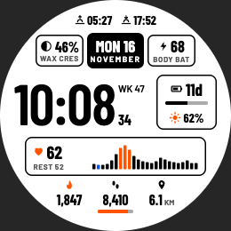
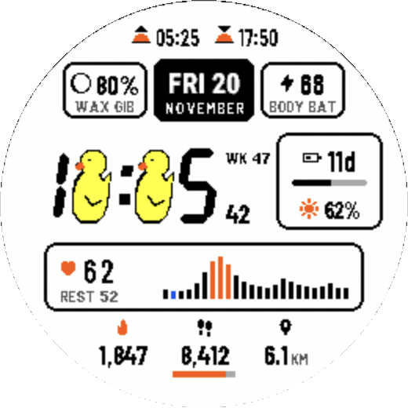
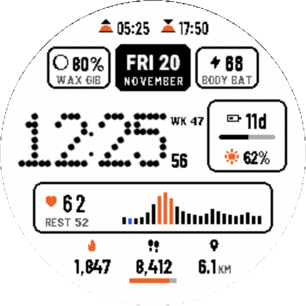

# Instrument Panel

**A production watch face for the Garmin fēnix 8 Solar, written in Monkey C, and the engineering behind it.**

Instrument Panel is a Connect IQ watch face for a 260 × 260 px always-on memory-in-pixel (MIP) display with 64
colours. It was built from a written design spec in eight milestones, passed Garmin's review, and was published on the
[Connect IQ Store](https://apps.garmin.com/en-US/apps/00cf4841-a09d-4a96-972b-a67b8fb4c242) as version 1.0.0.

[:material-watch: Get it on the Connect IQ Store](https://apps.garmin.com/en-US/apps/00cf4841-a09d-4a96-972b-a67b8fb4c242){ .md-button .md-button--primary }
[:fontawesome-brands-github: Source on GitHub](https://github.com/davidbejar/garmin-mip-face-1){ .md-button }

These pages are about the code rather than the product. They document how a dense, always-on, data-heavy screen fits
into a small memory budget and a strict power budget. They also cover the tooling built around the code to make
design decisions measurable.

<figure markdown>

<figcaption>Design mockup: the everyday state</figcaption>
</figure>
<figure markdown>

<figcaption>Simulator: 7-segment time drawn in code, rubber duck mode on</figcaption>
</figure>
<figure markdown>

<figcaption>Simulator: 5×7 dot-matrix time drawn in code</figcaption>
</figure>

<strong>2,488</strong>lines of Monkey C in 13 files

<strong>~1,500</strong>lines of Python tooling: fonts, previews, API checks, docs

<strong>48 KB</strong>runtime memory (default settings) of a 126.8 KB limit

<strong>0</strong>allocations per frame in <code>onUpdate()</code> and <code>onPartialUpdate()</code>

<strong>~1 ms</strong>per-second partial update (simulator, 4 ms worst case)

<strong>14</strong>data fields, each with a defined fallback for missing data

## What is technically interesting here

-   :material-refresh: **[A rendering pipeline that never allocates](architecture/rendering.md)**

    ---

    Data is refreshed once a minute behind change keys and dirty flags. Each frame is pure drawing from cached
    strings, positions and colours. Object allocation is confined to layout, settings changes and a 10-minute
    sensor-history refresh.

-   :material-battery-clock: **[Always-on seconds within a power budget](architecture/low-power.md)**

    ---

    In low power the face redraws once a minute, and `onPartialUpdate` repaints only a clip rectangle around the
    seconds every second. The clip is sized from font metrics. If the watch reports a blown power budget, the face
    falls back cleanly.

-   :material-memory: **[Memory as a first-class constraint](architecture/memory.md)**

    ---

    Glyph-subset bitmap fonts, run-length-encoded icons, flat constant tables, lazy loading of the one chosen time
    font, and debug code removed by build annotations. Memory was measured and recorded at every milestone.

-   :material-format-font: **[A bitmap font pipeline](graphics/fonts.md)**

    ---

    A Python generator rasterises TTFs into BMFont atlases with three edge modes, fixed-width digits, whole-pixel
    letter spacing and hand-drawn replacement glyphs for 7 px digits that hinting could not render cleanly.

-   :material-vector-polygon: **[Geometry drawn at runtime](graphics/time-styles.md)**

    ---

    A slanted 7-segment display from hexagonal polygons and a bit-mask table, a dot-matrix font from 5-bit rows, and a
    rubber duck whose outline comes from a mitred polygon-offset algorithm, all precomputed and then translated
    without allocation.

-   :material-chart-bar: **[Sensor data with honest fallbacks](data/sources.md)**

    ---

    Complications, sensor history, activity monitoring and system stats, each guarded with capability checks and
    given a documented fallback. The heart-rate graph buckets 4 hours of samples into 24 bars and adapts when the
    device keeps less history.

-   :material-tools: **[Tooling that makes design decisions measurable](tooling/preview.md)**

    ---

    A pixel-accurate preview renderer snaps candidate designs to the 64-colour palette and checks every option over
    all 1,440 minutes of the day before any Monkey C is written. A local API checker reads the SDK docs to confirm
    signatures, API levels and device support.

-   :material-clipboard-check: **[A spec-driven, milestone-based process](process/milestones.md)**

    ---

    One written spec, eight milestones, a warning-free build after every change, simulator verification against
    mockups, and a decision log for every deviation from the spec.

## Technology

| Area | Choice |
|------|--------|
| Language | Monkey C, with strict type annotations (`as Number`, `as Array<Float>`, nullable `?` types) |
| Platform | Garmin Connect IQ SDK 9.3, device API level 6.0, `minApiLevel` 4.2.1 |
| Target | fēnix 8 Solar 47mm (`fenix8solar47mm`): round 260 × 260 px MIP display, 64 colours, always on |
| Toybox modules | `WatchUi`, `Graphics`, `Complications`, `SensorHistory`, `ActivityMonitor`, `UserProfile`, `System`, `Time`, `Application` |
| Permissions | `ComplicationSubscriber`, `SensorHistory`, `UserProfile` (nothing else) |
| Tooling | Python 3 with Pillow and NumPy (font generation, design previews, docs figures), Bash build script |
| Fonts | Barlow, Barlow Condensed, Saira Condensed, Kalam (SIL Open Font License), converted to bitmap atlases |
| Distribution | [Connect IQ Store](https://apps.garmin.com/en-US/apps/00cf4841-a09d-4a96-972b-a67b8fb4c242), version 1.0.0 (tagged `v1.0.0` in git) |

## Where to start

- **Short on time?** Read [the rendering pipeline](architecture/rendering.md) and
  [memory engineering](architecture/memory.md). They show the main constraints and how the code works within them.
- **Interested in algorithms?** See [ISO week numbers and moon phases](data/calendar-and-moon.md),
  [the heart-rate graph](data/heart-rate-graph.md), and [polygon offsetting for the duck outline](graphics/time-styles.md#outline-by-polygon-offsetting).
- **Interested in process?** See [milestones](process/milestones.md) and the [decision log](process/decisions.md).
