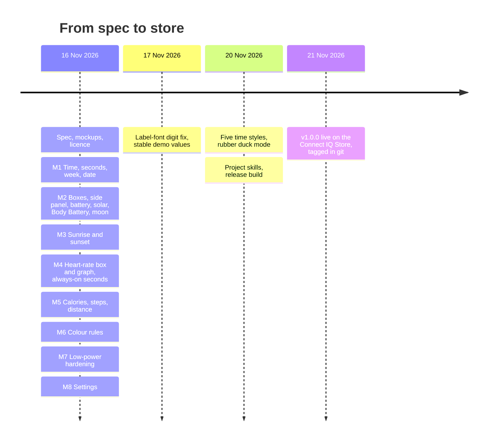

# Spec-driven milestones

## Starting from a written spec

The project started from a design spec (`design/spec.md`) and three mockups before any code existed. The spec defines:

- **coordinates** for every element on a 260 px canvas, plus type sizes and weights
- the **icon** list and how each is coloured
- the **palette**, restricted to the 64 MIP colours
- the **colour rules**, as a condition/effect table
- the **data source** for each field, its format and its fallback when there's no data
- **low-power** behaviour, **settings** and **permissions**
- a **"done when"** checklist

API names written from memory were marked **(check)** in the spec, and each one had to be confirmed in the SDK docs
before use ([API verification](../tooling/api-check.md)).

## Working rules

The project's instructions set the rules that shaped the code:

- Position everything from `dc.getWidth()` and `dc.getHeight()`, scaled from the 260 px spec, with no hard-coded
  pixels.
- Use only the 64 MIP colours.
- No object allocation in `onUpdate()`. Load fonts and bitmaps once.
- Every data field handles `null` and shows the spec's fallback.
- Always-on seconds through `onPartialUpdate`, with exactly one allowed exception (the power-budget callback).
- Never guess an API.
- Request only the permissions the code uses.
- Prefer drawing in code to loading images, and report memory after each milestone.
- Build after every change, and fix every warning before moving on.
- When a simulator screenshot arrives, list its differences from the mockup **before** changing any code.

## The milestones

Each milestone ended with a warning-free build, a simulator check by the owner against the mockups, a memory report
and a commit. The next milestone started only after approval.



| # | Milestone | Highlights | Memory |
|---|-----------|------------|-------:|
| 1 | Time, seconds, week number, date block | Project scaffold, bitmap time font, ISO week, letter-spaced month, `.env` key handling | 13.0 KB |
| 2 | Boxes, side panel, battery, solar, Body Battery, moon | Complication subscription, procedural moon, run-length icons, hard-edged number fonts | 22.5 KB |
| 3 | Sunrise and sunset row | Complications instead of location (no `Positioning` permission), new sun-event icons | 25.2 KB |
| 4 | Heart-rate box and graph | `SensorHistory` bucketing, 10-minute refresh, fixed-width digits, **always-on seconds** with partial updates | 30.0 KB |
| 5 | Tile row | Thousands separators, km/mi from the device setting, redesigned steps icon, centred steps bar | 33.6 KB |
| 6 | Colour rules | `ColourRules` module, debug-only demo mode for the three mockup states | 35.9 KB |
| 7 | Low-power behaviour | Clip-only repaint, metrics-derived clip, 10-minute staleness limit for the HR fallback, power-budget path | 35.5 KB |
| 8 | Settings | Index-based properties, Garmin Connect + simulator + on-watch `Menu2`, rule-safe colour options | 38.2 KB |
| — | Time styles and rubber duck | `TimeDisplay`, 7-segment and dot matrix in code, polygon offsetting, preview tooling, project skills | 48.4 KB |

## Commits as documentation

Each milestone commit message records **what** changed, **why** (especially when the result differs from the
mockup), **how it was verified**, and the **memory** figure. For example, milestone 7:

```text
Milestone 7: low-power behaviour verified and hardened

- onPartialUpdate paints exactly the seconds clip with fillRectangle
  instead of dc.clear(); clip checked against the font metrics to contain
  every value 00-59 at any time width and to clear its neighbours.
- Current heart rate falls back to the newest history sample only while it
  is at most 10 minutes old (owner's decision), re-checked every minute.
- Verified in the simulator (Display Mode > Always-On): full redraw once a
  minute, seconds tick via partial updates (~1 ms avg, 4 ms max on the
  host), wake returns to per-second redraws, and the power-budget fallback
  hides the seconds while asleep and restores them on wake. ...

Memory: 35.5 KB of 126.8 KB (debug build).
```
