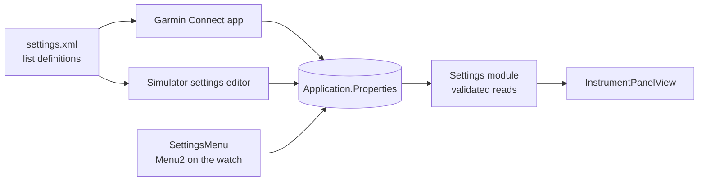
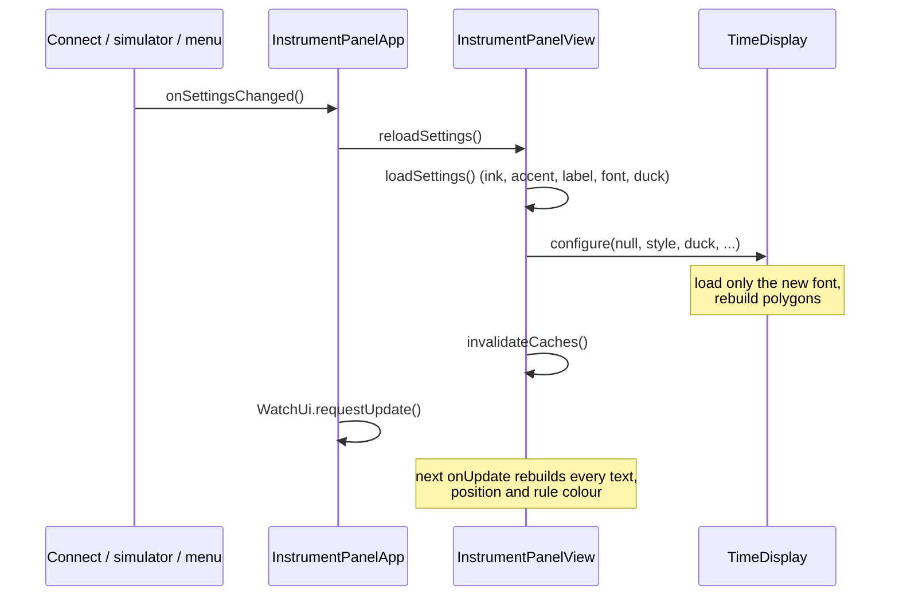

# Settings

The face has five settings, available in three places from a single definition: Garmin Connect on the phone, the
simulator's settings editor, and a native menu on the watch.

| Setting | Options (stored index) | Default |
|---------|------------------------|---------|
| Text colour | Black (0), Navy (1), Dark purple (2) | Black |
| Accent | Orange (0), Magenta (1), Amber (2) | Orange |
| Heart-rate label | Resting `REST` (0), 4-hour max `MAX` (1) | REST |
| Time font | Classic (0), Bold (1), LCD (2), Dot matrix (3), Handwritten (4) | Classic |
| Rubber duck mode | Off (0), On (1) | Off |

## Storage: indexes, not values

Every setting is stored as a **number index** into an option list in code, not as a colour value or string:

```xml
<!-- resources/settings/properties.xml -->
<properties>
    <property id="TextColour" type="number">0</property>
    <property id="AccentColour" type="number">0</property>
    <property id="HeartRateLabel" type="number">0</property>
    <property id="TimeFont" type="number">0</property>
    <property id="RubberDuck" type="number">0</property>
</properties>
```

```js
const TEXT_COLOURS = [0x000000, 0x000055, 0x550055] as Array<Number>;

function textColour() as Number {
    return TEXT_COLOURS[index(TEXT_COLOUR, TEXT_COLOURS.size())];
}

//! Stored index for key, or 0 (the default) if missing or out of range.
function index(key as String, count as Number) as Number {
    try {
        var v = Properties.getValue(key);
        if (v instanceof Number && v >= 0 && v < count) {
            return v;
        }
    } catch (e) {
    }
    return 0;
}
```

This has several benefits:

- **Only valid colours can reach the screen.** A corrupted or hand-edited value can't produce a non-MIP colour. It
  falls back to the default.
- **Option lists can change.** New options can be appended without migrating stored values.
- **One validator for everything.** Type check, range check and exception handling live in one function.

## Three front ends, one definition



- **Garmin Connect and the simulator** read `settings.xml`, which maps each property to a list of labelled values.
- **On the watch**, `AppBase.getSettingsView()` returns a two-level `Menu2`. The top level shows each setting with
  its current option as a sub-label. Selecting one pushes an option list with the current choice ticked and focused.
  Choosing an option writes the index, updates the parent's sub-label and pops back.

The on-watch menu is built from three parallel tables (`KEYS`, `title()`, `optionNames()`) indexed by setting number,
so one generic delegate handles all five settings. Menu objects exist only while the menu is open, so they don't add
to the face's resident memory.

## Applying a change



`TimeDisplay.configure` is called with `dc = null` here, because there is no drawing context outside `onLayout`. It
sets `_measured = false`, and the glyph advances are measured lazily on the next `layout()`, which does receive a
`dc`.

## Choosing the options

The colour options were chosen against the [colour rules](graphics/colour.md#user-colours-that-cannot-hide-a-warning).
None of the text or accent options is red, green or blue, so a warning or a reached target is always visible. The
time styles and the duck were picked from rendered previews (see [Time styles](graphics/time-styles.md)).
